

  <a href="https://abdelkafi-oumnih.vercel.app">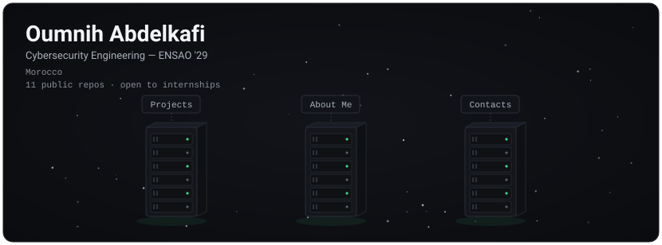</a>
  
  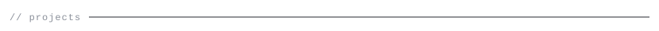
  <a href="https://github.com/abdelkafi007/SSH-Honeypot">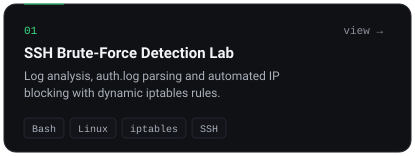</a><a href="https://github.com/abdelkafi007/mcserver-dashboard">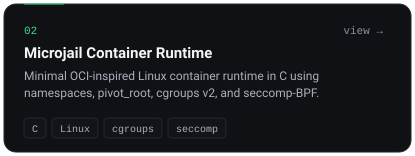</a>
  <a href="https://github.com/abdelkafi007/OverTheWire-Bandit-Writeups">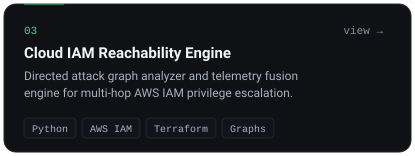</a><a href="https://github.com/abdelkafi007/SentinelSOC">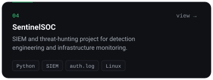</a>
  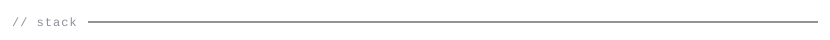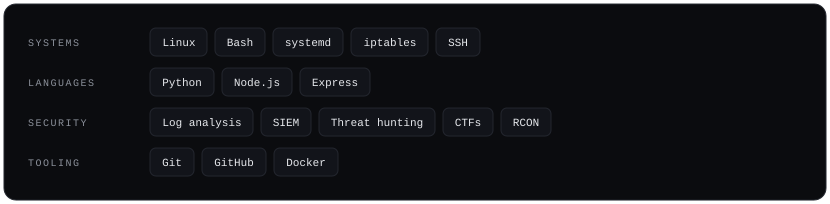
  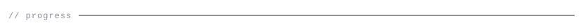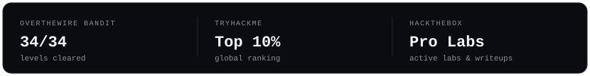
  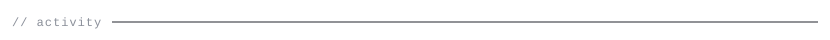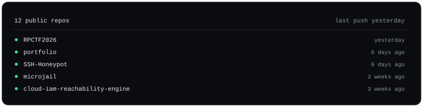
  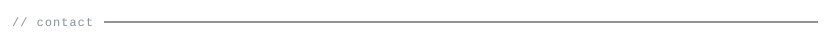
    
  

