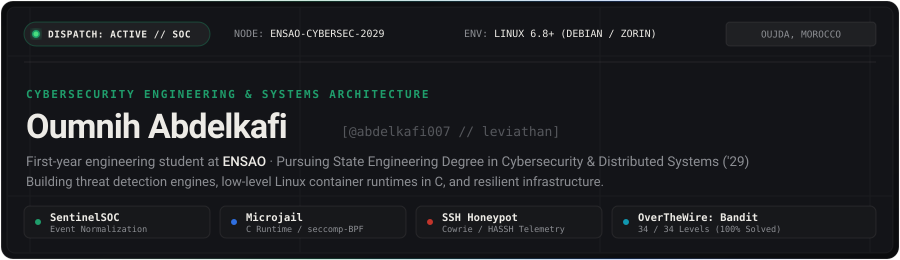

<div align="center">

<!-- HERO DOSSIER BANNER (Dynamic Dark/Light) -->
<picture>
  <source media="(prefers-color-scheme: dark)" srcset="dark.svg">
  <source media="(prefers-color-scheme: light)" srcset="light.svg">
  
</picture>

<br/><br/>

<!-- TELEMETRY & VERIFIED CREDENTIAL BADGES -->
<a href="https://abdelkafi-oumnih.vercel.app/" target="_blank">
  
</a>
&nbsp;
<a href="https://abdelkafi007.github.io/writeups" target="_blank">
  
</a>
&nbsp;
<a href="https://linkedin.com/in/abdelkafi-oumnih-91b37b32b/" target="_blank">
  
</a>
&nbsp;
<a href="mailto:oumnihabdelkafi0@gmail.com">
  
</a>

<br/><br/>

<!-- SYSTEMS & SECURITY TELEMETRY MATRIX (Dynamic Dark/Light) -->
<picture>
  <source media="(prefers-color-scheme: dark)" srcset="dashboard-dark.svg">
  <source media="(prefers-color-scheme: light)" srcset="dashboard-light.svg">
  
</picture>

</div>

---

### `// 01. DOSSIER & BACKGROUND`

I am **Oumnih Abdelkafi**, a Cybersecurity Engineering student at **ENSAO** (*École Nationale des Sciences Appliquées d'Oujda, Morocco*), pursuing a State Engineering Degree in Cybersecurity & Distributed Information Systems (**Class of 2029**).

I focus on **defensive security architecture**, **systems programming in C**, and **low-level Linux security**. My engineering approach is grounded in first-principles understanding: from writing container runtimes from scratch with Linux namespaces and `seccomp-BPF`, to building SIEM log normalization engines and containerized deception nodes.

- **Status:** Actively seeking **Cybersecurity & Systems Engineering Internships** (SOC Analysis, Detection Engineering, Infrastructure Security).
- **Environment:** Daily driver: Debian Bookworm / Zorin OS Linux (Kernel 6.8+).
- **Research Platform:** [Live 3D Systems Portfolio](https://abdelkafi-oumnih.vercel.app/) · [CTF Writeups Archive](https://abdelkafi007.github.io/writeups).

---

### `// 02. FLAGSHIP ENGINEERING REPOSITORIES`

| System / Repository | Domain | Architectural Highlights & Capabilities | Stack |
| :--- | :--- | :--- | :--- |
| **[SentinelSOC](https://github.com/abdelkafi007/SentinelSOC)** | SIEM & Threat Ingestion | Modular security operations framework for edge Linux servers. Ingests raw authentication logs (`auth.log`), normalizes disparate event streams, detects brute-force and privilege escalation anomalies, and emits alerts with **zero cloud dependencies**. | `Python 3.11` `SIEM` `auth.log` `Anomaly Engine` |
| **[Microjail](https://github.com/abdelkafi007/microjail)** | Systems Programming | Minimal OCI-inspired container runtime built in C. Implements strict process isolation using Linux namespaces (`PID`, `MOUNT`, `NET`), `pivot_root`, `cgroups v2` resource quotas, and a custom `seccomp-BPF` syscall firewall. | `C` `Namespaces` `cgroups v2` `seccomp-BPF` |
| **[SSH Honeypot](https://github.com/abdelkafi007/SSH-Honeypot)** | Deception Engineering | Containerized Cowrie deception node deployed on Debian Bookworm. Collects real-world adversary telemetry: brute-force velocities, cryptographic HASSH fingerprints, live TTY terminal session replays, and isolated malware payload harvesting. | `Cowrie` `Docker` `Debian` `HASSH` `Telemetry` |
| **[Threat Intel Triage](https://github.com/abdelkafi007/Threat-Intel)** | SOC Automation | Asynchronous CLI for SOC analysts. Parses and classifies indicators (IPv4, Domain, MD5, SHA256), concurrently queries VirusTotal and AbuseIPDB via `httpx`/`asyncio`, and computes a multi-factor risk verdict matrix. | `Python 3` `asyncio` `httpx` `Typer` `Rich` |
| **[Cloud IAM Reachability](https://github.com/abdelkafi007/cloud-iam-reachability-engine)** | Cloud Security | Graph-based Identity & Access Management reachability analyzer. Maps policy grants, detects privilege escalation paths across IAM roles, and surfaces unauthorized cloud access boundaries. | `IAM` `Cloud Security` `PrivEsc` `Graph Theory` |
| **[OverTheWire Bandit Writeups](https://github.com/abdelkafi007/OverTheWire-Bandit-Writeups)** | Wargames & Internals | Comprehensive walkthrough of all 34 levels (0–34) of the OverTheWire Bandit wargame: POSIX command-line mastery, SUID binary exploitation, SSH tunneling, cron hijacking, and socket communication. | `Linux CLI` `SUID PrivEsc` `SSH Tunneling` `100% Solved` |
| **[Minecraft Server Ops](https://github.com/abdelkafi007/mcserver-dashboard)** | Systems Infrastructure | Automated deployment pipeline with `systemd` daemon isolation, authenticated RCON protocol socket communication, and automated scheduled backup rotation. | `Linux Systemd` `RCON Socket` `Node.js` `Bash` |

---

### `// 03. TECHNICAL CAPABILITIES & TOOLCHAIN`

```
┌─────────────────────────┬────────────────────────────────────────────────────────────────────────┐
│ DOMAIN                  │ TECHNOLOGIES & TOOLCHAIN                                               │
├─────────────────────────┼────────────────────────────────────────────────────────────────────────┤
│ Low-Level & Systems     │ C · Linux Kernel (6.8+) · Namespaces · cgroups v2 · seccomp-BPF · POSIX│
│ Defensive Security      │ Log Normalization · SentinelSOC · Cowrie Honeypot · HASSH · Fail2ban   │
│ Network & Firewall      │ iptables / nftables · SSH Tunneling · Wireshark · Nmap · Socket IPC    │
│ Languages & Runtimes    │ C · Python 3.11 (asyncio, httpx) · Bash · Node.js · TypeScript · SQL   │
│ Wargames & Verification │ OverTheWire Bandit (Levels 0–34 Complete) · SUID PrivEsc · CTF Research│
│ Infrastructure & DevOps │ Debian Bookworm · Zorin OS · Docker · Systemd Isolation · Git · GitHub │
└─────────────────────────┴────────────────────────────────────────────────────────────────────────┘
```

---

<div align="center">

### `// 04. GITHUB TELEMETRY`

<table border="0">
  <tr>
    <td align="center">
      <a href="https://github.com/abdelkafi007">
        
      </a>
    </td>
    <td align="center">
      <a href="https://github.com/abdelkafi007">
        
      </a>
    </td>
  </tr>
</table>

<br/>

<!-- REFINED TERMINAL FOOTER STRIP -->
<code>SYSTEM PORT 443 [ESTABLISHED] · ENSAO CYBERSECURITY '29 · REPOSITORIES VERIFIED</code>

<br/><br/>

<a href="https://abdelkafi-oumnih.vercel.app/">
  
</a>

</div>
